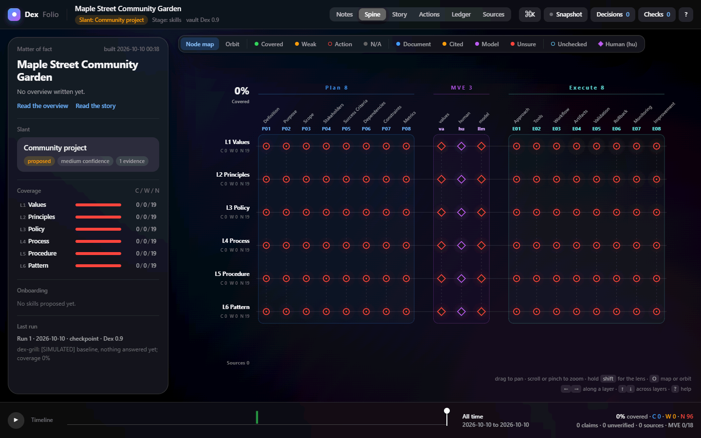
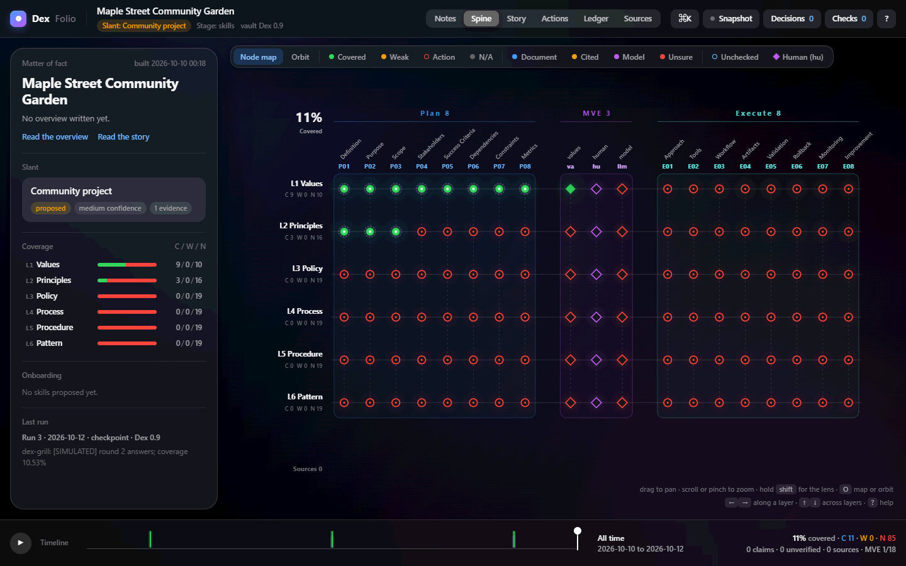
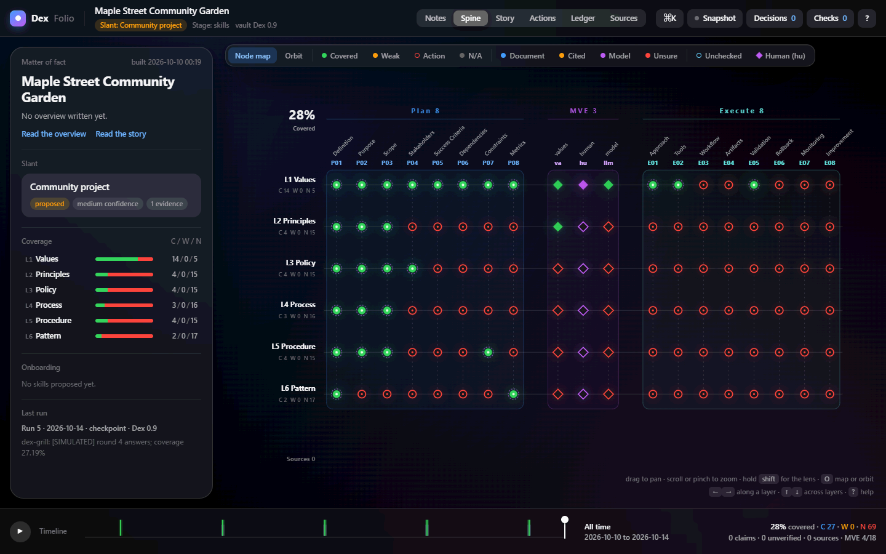
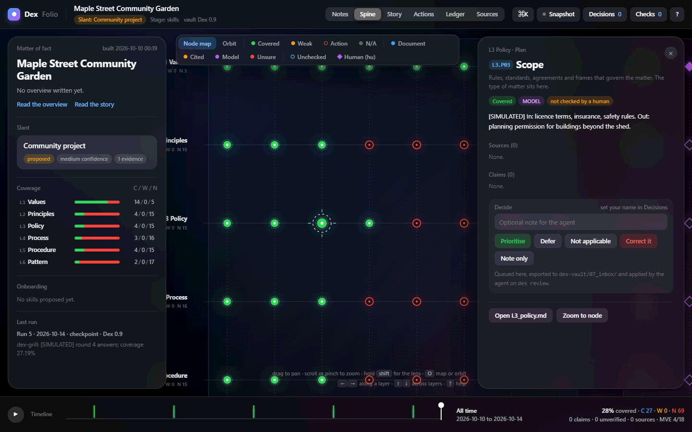
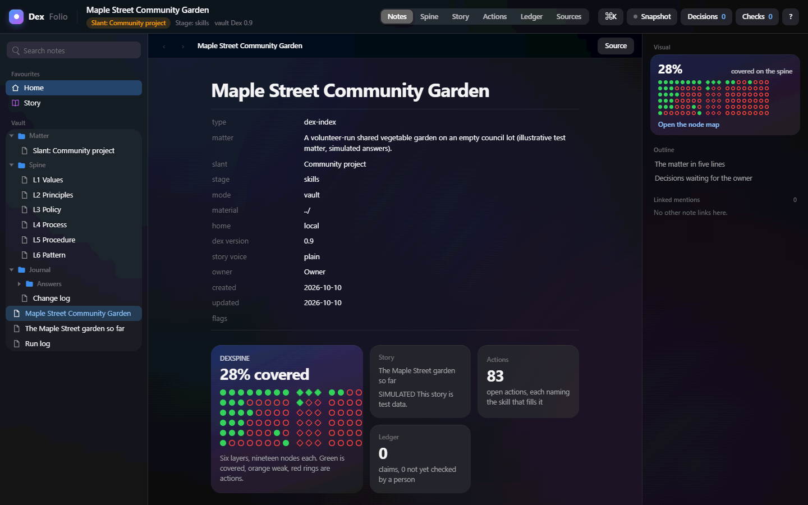
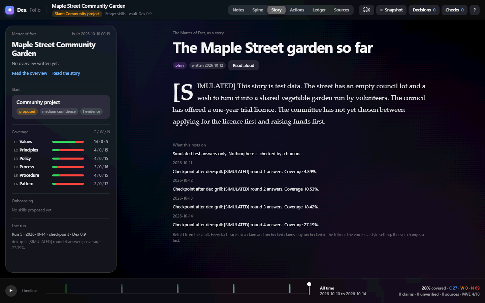
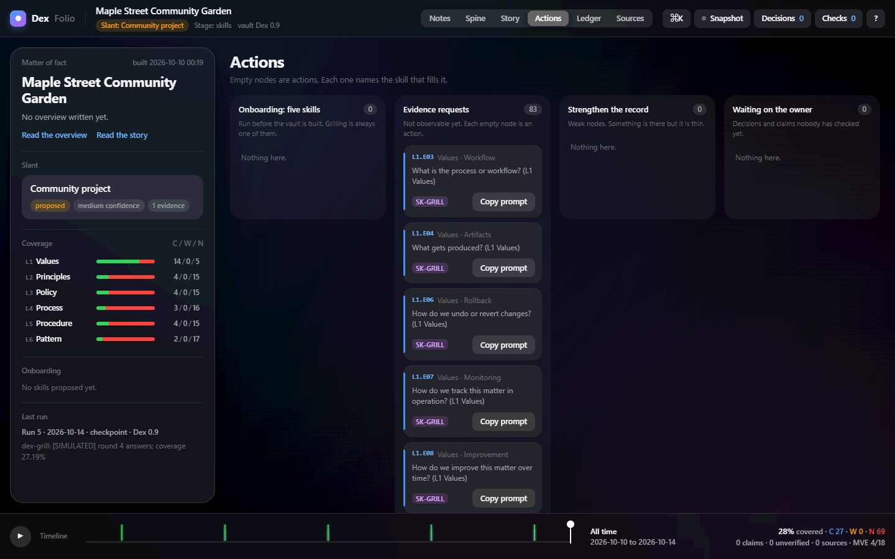

# DexFolio

**Turns a Dex vault into one HTML page you can read anywhere: offline, in any browser, on a phone too.**

A Folio shows everything in a `dex-vault` at a glance: the spine node map (what is covered, what is weak), the notes, the story, the actions waiting, the claims ledger, the sources, a timeline, the decisions and a health check of the vault. It only reads; it never changes the vault.

> **This repo is parked.** DexFolio is now the Folio that [dex.md](https://github.com/Dex-RoboKnix/dex-md) builds for every vault; its builders and template live in the dex-md repo (`engine/`). This repo keeps v0.1.0, where the Folio started. To get a Folio, use dex.md.

**Layer: L2**, a product that follows the DexSpine standard (L1). Pre-1.0 · [AGPL-3.0-or-later](LICENSE)

## Use it

In a folder with a `dex-vault/` that dex.md built:

```sh
node dex-vault/.dex/build_folio.mjs            # build dex-vault/dex-folio.html and take a snapshot
node dex-vault/.dex/build_folio.mjs --changes  # list what changed since the last snapshot
```
Readable: the first builds the page and remembers the state of the vault; the second lists what changed since then, without building.

Node 18 or later, no packages. `build_folio.py` does the same with Python. Open `dex-vault/dex-folio.html` in any browser; **Link folder** gives a live view.

## Where the Folio lives now

dex.md installs the Folio builders and template into `dex-vault/.dex/` at Stage 2 and rebuilds the page at every checkpoint. They started from this repo at [v0.1.0](RELEASE.md) and have moved on in dex-md: dex.md 0.12.0 adds a plain view, every note also written as static HTML for phones and file previews that never run scripts. Changes to the Folio are made there, not here.

## Which document do I read?

| You are | Read |
|---|---|
| A person who wants a Folio | [dex.md](https://github.com/Dex-RoboKnix/dex-md): it builds one for you. Then open `dex-vault/dex-folio.html` |
| A person who wants to change the Folio | The dex-md repo, `engine/build/src/` |
| A person who wants to know what each view shows | [`docs/folio.md`](docs/folio.md) |
| An agent or person working on this repo | [`START.md`](START.md), then `CLAUDE.md` |

## What using a folio looks like

Screenshots from an emulated test session on an illustrative project (a community garden plan). Every answer shown is **simulated test data**, labelled `[SIMULATED]`, written by a test harness and not by a person. Steps and findings: [docs/user-test.md](docs/user-test.md).

**1. Before any answers.** The spine node map of a freshly scaffolded vault: 0% covered, every node an open question.



**2. After round 2.** Answering questions turns nodes green. 12 of 114 nodes covered (10.53%).



**3. After round 4.** 31 of 114 nodes covered (27.19%); the layer bars on the left climb with them.



**4. A node open.** Clicking a node shows its answer (still tagged `[SIMULATED]` and "not checked by a human") and the decide buttons.



**5. Notes (home).** The vault home with the coverage tile, story and open-action counts.



**6. Story.** The story view, with one line per checkpoint and its coverage.



**7. Actions.** Every node still empty is an action that names the skill that fills it.



## Licence

AGPL-3.0-or-later, the open Core edition. No Enterprise edition exists.

## Related

- [dex-md](https://github.com/Dex-RoboKnix/dex-md): dex.md, the way in. One file that builds a DexSpine vault in any project folder.
- [dexspine-core](https://github.com/Dex-RoboKnix/dexspine-core): the DexSpine standard and the DEX838 parser.
