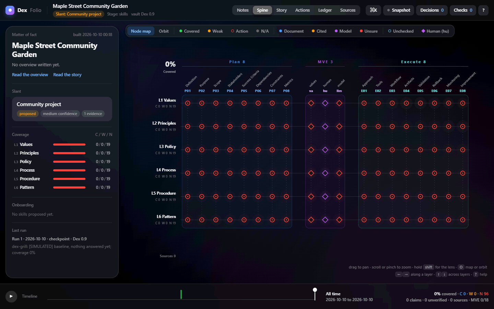
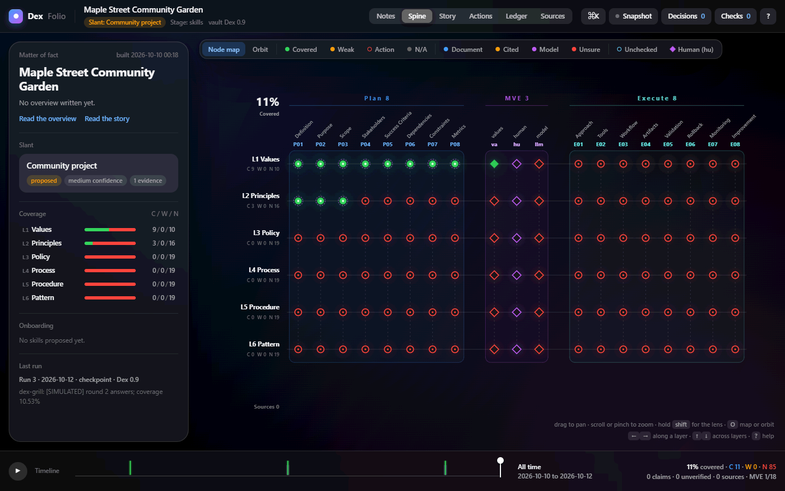
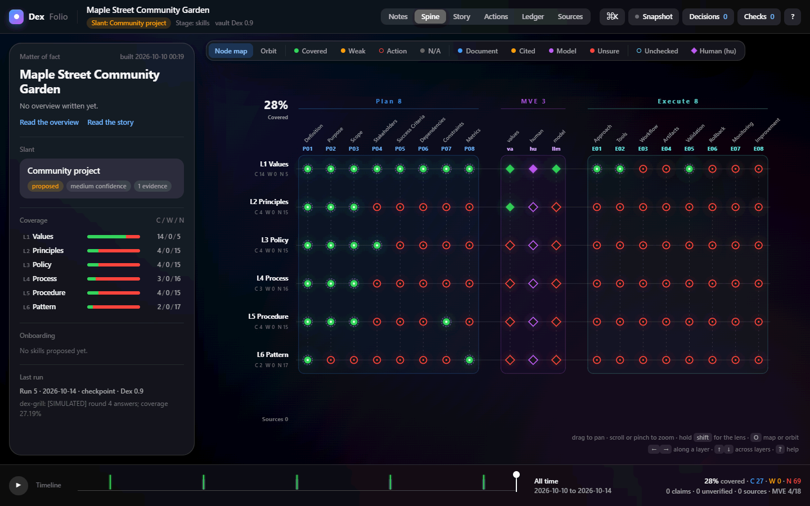
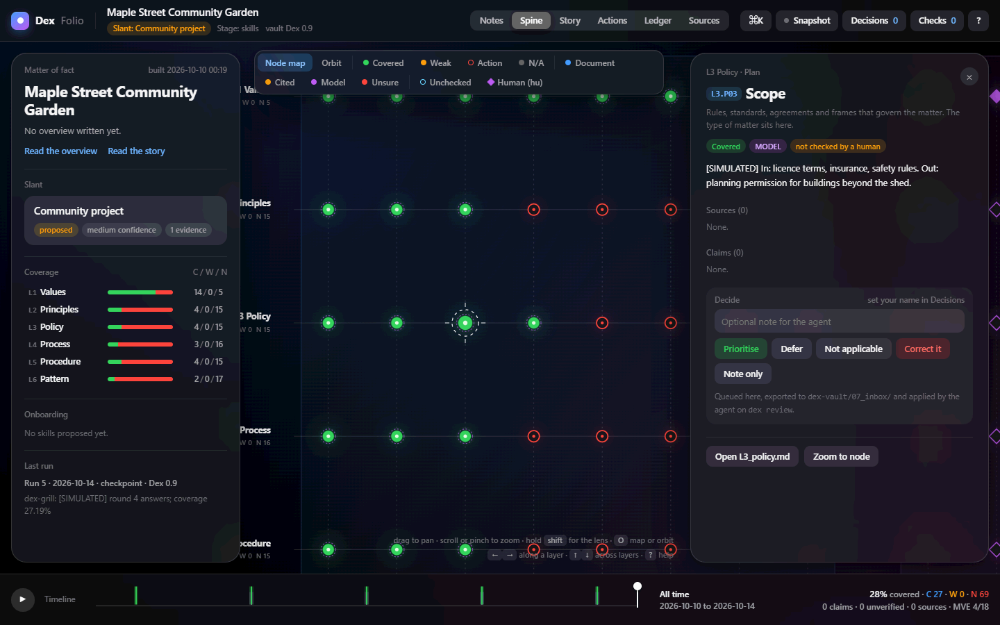
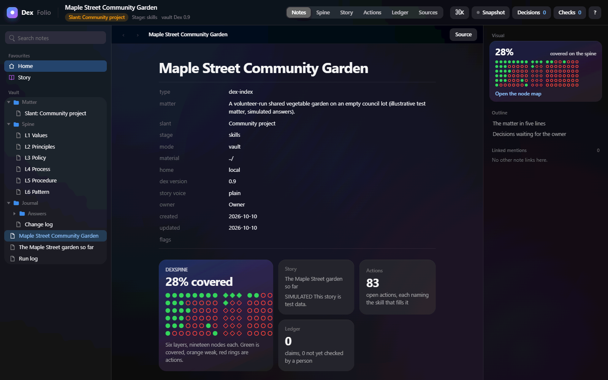
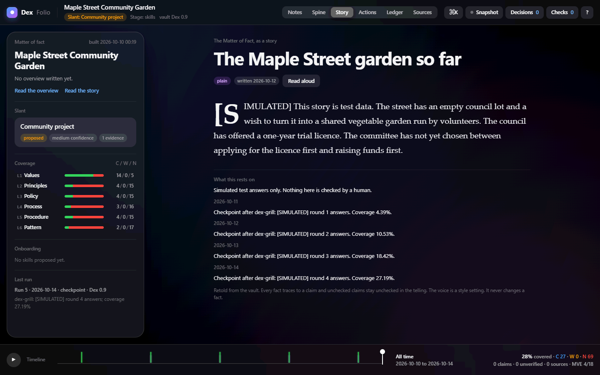
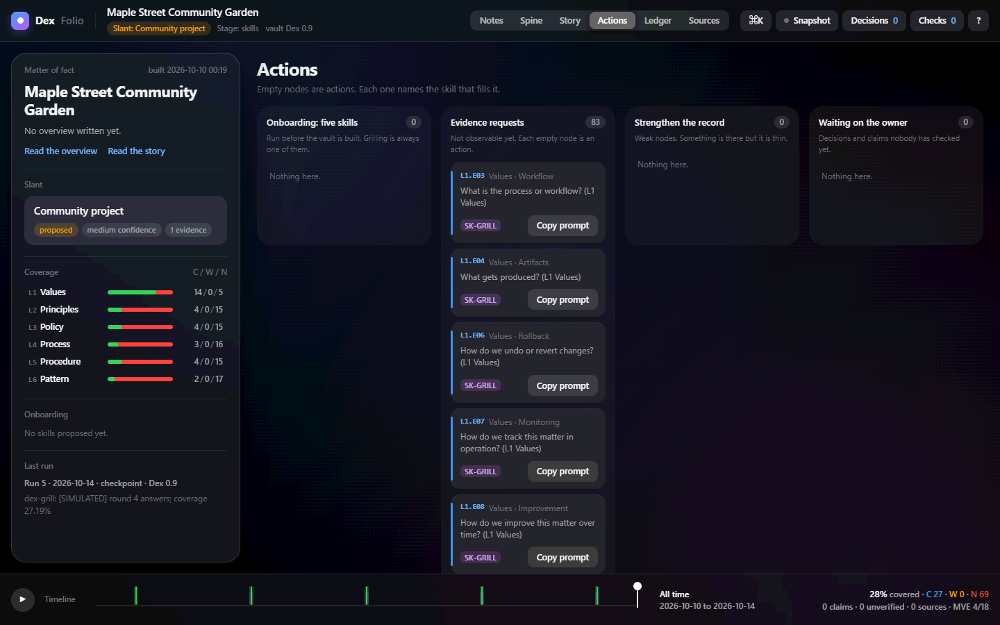

# DexFolio

Layer: **L2**, DexFolio. Pre-1.0 prototype. Part of DexRoboKnix: see the [sitemap](https://github.com/Dex-RoboKnix/Dex_RoboKnix/blob/main/SITEMAP.md).

A folio is a read-only, single-file HTML view of a `dex-vault`: notes, spine node map, story, actions, ledger, sources, timeline, decisions and health checks. This repo is the source of truth for its builders and template.

## What dex.md uses it for

dex-md vendors the files in `src/` at a pinned dexfolio tag (see `RELEASE.md`) and installs them into `dex-vault/.dex/` at Stage 2. Vendored copies must be byte-identical to the tag.

## Use

```
node dex-vault/.dex/build_folio.mjs            # build dex-vault/dex-folio.html and take a snapshot
node dex-vault/.dex/build_folio.mjs --changes  # list changes since the last snapshot
```
Python alternative: `build_folio.py` (same behaviour). Node 18+, no packages.

Test: `npm test`.

## What using a folio looks like

Screenshots from an emulated test session on an illustrative project (a community garden plan). Every answer shown is **simulated test data**, labelled `[SIMULATED]`, written by a test harness and not by a person. Steps and findings: [docs/user-test.md](docs/user-test.md).

**1. Before any answers.** The spine node map of a freshly scaffolded vault: 0% covered, every node an open question.



**2. After round 2.** Answering questions turns nodes green. 12 of 114 nodes covered (10.53%).



**3. After round 4.** 31 of 114 nodes covered (27.19%); the layer bars on the left climb with them.



**4. A node open.** Clicking a node shows its answer (still tagged `[SIMULATED]` and "not checked by a human") and the decide buttons.



**5. Notes (home).** The vault home with the coverage tile, story and open-action counts.



**6. Story.** The story view, with one line per checkpoint and its coverage.



**7. Actions.** Every node still empty is an action that names the skill that fills it.



## Licence

OpenCore: this Core edition is AGPL-3.0 ([`LICENSE`](LICENSE)). No Enterprise edition exists.
